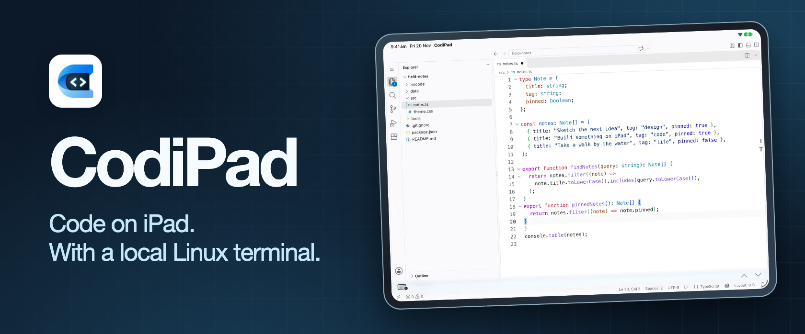
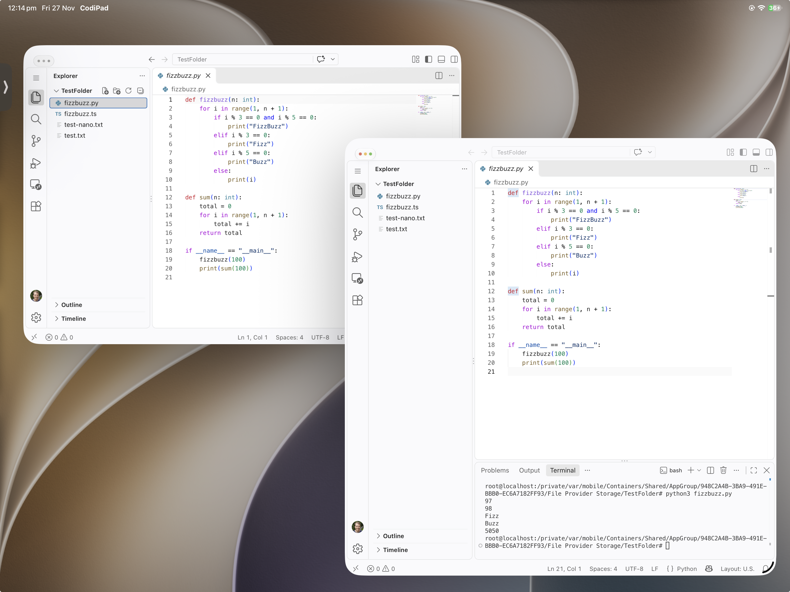
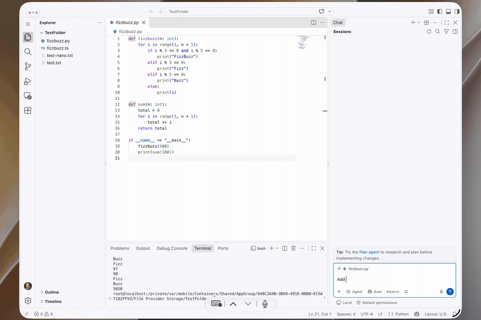
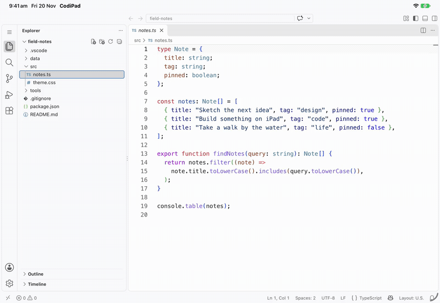
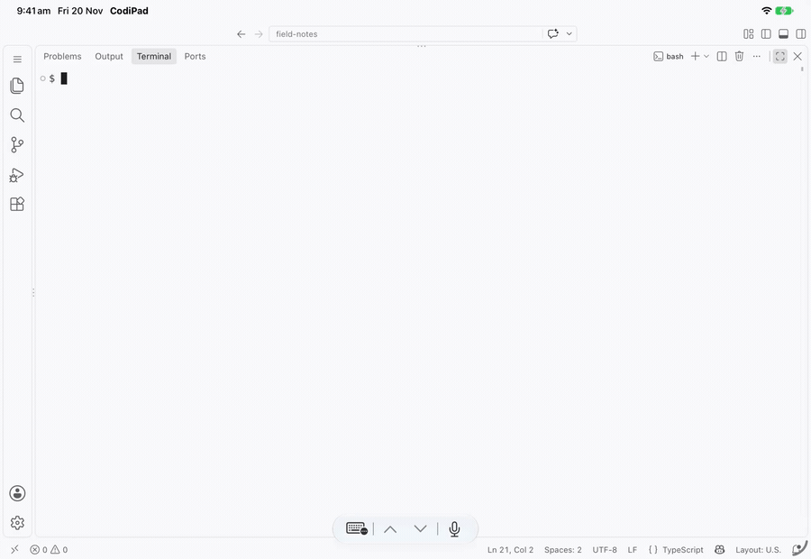
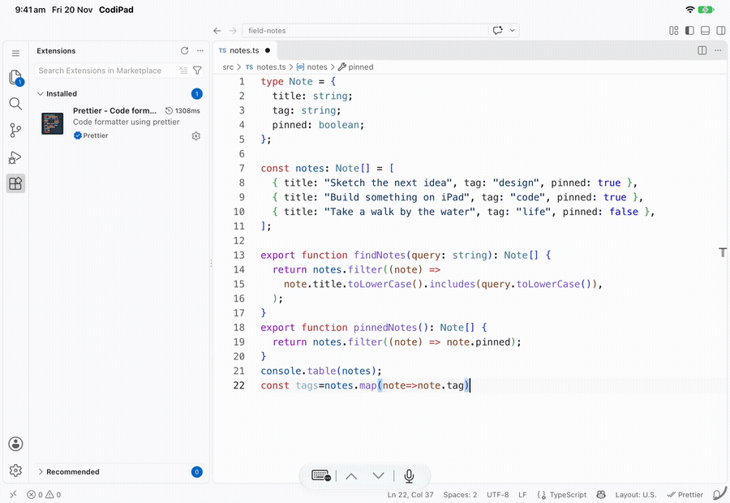

<h1></h1>

CodiPad is built on Code - OSS, the open-source project behind Visual Studio Code. On iPadOS 18 and later, open a project from Files, edit a TypeScript file, then run `npm start` against the same folder in a local Debian terminal. Both the editor and the shell run on your iPad.

[Install on your iPad](docs/build.md#install-on-an-ipad) · [Try the simulator](docs/build.md#run-in-the-simulator) · [Contribute](CONTRIBUTING.md)

## See CodiPad in action



*Two editor windows on a 13-inch iPad.*

### Write Python tests with GitHub Copilot

Copilot adds tests for `fizzbuzz.py` and asks to run them. All eight pass in CodiPad’s terminal. This recording uses the [optional VS Code components](docs/build.md#optional-vs-code-components).

[](media/demos/copilot-python-tests.mp4)

### Edit, run, and format TypeScript

These recordings follow a TypeScript project called *Field notes* in the iPad simulator. Select a preview to watch the full-size MP4.

| Edit a TypeScript file | Run it with Node.js | Format it with Prettier |
| :--- | :--- | :--- |
| [](media/demos/editing.mp4) | [](media/demos/terminal.mp4) | [](media/demos/extensions.mp4) |

## Inside the app

- **Files and windows.** Choose a project folder in Files and save edits directly to it. Open a second workspace in its own window while keeping the first project on screen.
- **Local Linux tools.** The integrated terminal runs Debian ARM64 through iSH. The bundled environment includes Bash, Node.js, Git, Python, uv, and ripgrep. Terminal processes end when iPadOS terminates the app.
- **Extensions.** Use **Extensions: Install from VSIX…** in the Command Palette to install a compatible extension from Files. Extension compatibility depends on the APIs and native binaries each extension needs.

## Build from source

Use an Apple silicon Mac with Xcode, Python 3.12 or later, Meson, Ninja, and a running Linux ARM64 Docker engine. From the repository root, build an unsigned app for iPadOS.

```sh
python3 scripts/build.py --sdk iphoneos --configuration Release
```

The first build downloads the pinned sources and prints the path to an unsigned `CodiPad.app`. To run it on a physical iPad, build with your Apple development team and bundle identifier. [Build the default app](docs/build.md#build-the-default-app) · [Sign and install on iPad](docs/build.md#install-on-an-ipad)

The default build uses no extension gallery. To connect a compatible self-hosted gallery, pass `--extension-gallery FILE`. Two independent options are available for separately authorized builds.

- `--with-microsoft-marketplace` connects the Extensions view to Microsoft’s gallery. [Marketplace setup and access terms](docs/build.md#build-with-microsoft-marketplace)
- `--with-vscode-extras` bundles the packaged Copilot extension, its local agent host, and the VS Code signing components. [Local setup and redistribution terms](docs/build.md#optional-vs-code-components)

## How it fits together

The [UIKit app](app/CodiPad) hosts Code - OSS in a `WKWebView`. The [workbench overlay](workbench/overlay) connects the editor to native file access, terminals, webviews, and extension services. By default, extensions run in a Linux Node.js process under iSH. The [native modules](native) also provide an embedded Node.js runtime.

The [build scripts](scripts) assemble these pieces from [upstream patches](patches), a [workbench source manifest](build/source-manifest.json), and a [runtime manifest](build/runtime-manifest.json). See the [contributing guide](CONTRIBUTING.md) to report a compatibility issue or work on the port.

## Credits and licenses

CodiPad is an independent project built on [Code - OSS](https://github.com/microsoft/vscode), [iSH](https://github.com/ish-app/ish), and the [ARM64 iSH port](https://github.com/OpenMinis/ish-arm64). Microsoft has no affiliation with CodiPad.

Original CodiPad code uses the [GNU General Public License v3.0 only](LICENSE). Third-party components retain their own licenses. See the [Node.js notices](native/CodiPadNode/NOTICE), [iSH notices](native/CodiPadProcess/NOTICE), and [workbench notices](workbench/notices). To distribute an IPA, follow the [binary release instructions](docs/build.md#prepare-a-binary-release).
